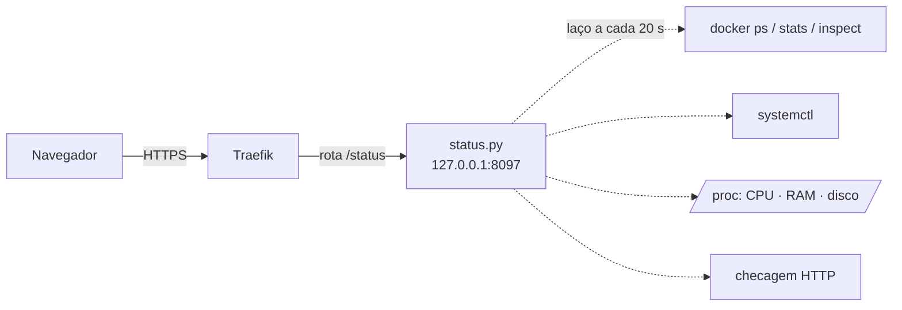

# Página de status da VPS · observabilidade leve, sem instalar nada pesado

`EM PRODUÇÃO` · Código de consulta neste repositório.

> *EN: Zero-dependency Python status dashboard for a single VPS: CPU/RAM/disk, Docker containers (health, restarts, OOM), systemd services and HTTP checks grouped by project, with on-demand logs and password login. Served behind Traefik.*

---

## O problema

Um servidor de 2 vCPU rodando n8n, Evolution API, bancos, workers de vídeo, TTS e vários robôs. Quando algo parava, eu só descobria quando o resultado não aparecia. Grafana e Prometheus seriam pesados demais para essa máquina.

## A solução

Um único arquivo Python, **sem dependências**, que junta o estado de tudo numa página no estilo Easypanel:

- **Servidor:** CPU, carga, RAM, swap, disco e tempo ligado
- **Containers:** estado, saúde, CPU e memória, reinícios e se já foram mortos por falta de memória (OOM)
- **Serviços systemd** e **sites** (código HTTP e tempo de resposta)
- **Agrupado por projeto**, como no Easypanel: cada projeto junta seus containers, serviços e URLs
- **Alertas** automáticos: item fora do ar, disco acima de 85%, memória acima de 90%, OOM
- **Logs na hora:** últimas 80 linhas de qualquer container ou serviço, com um clique



## Decisões técnicas

| Desafio | Como resolvi |
|---|---|
| Abrir a página não pode pesar no servidor | Coleta num laço de 20 s em thread separada. A página só lê o último estado |
| Dar acesso ao Docker sem expor o socket | O painel roda **no host** e escuta em 127.0.0.1. Um contêiner `alpine` mínimo (16 MB) só carrega as etiquetas de rota do Traefik |
| Login simples e seguro | Cookie HMAC `HttpOnly; Secure; SameSite`, comparação em tempo constante e atraso de 1 s em senha errada |
| Somente leitura | Nenhuma rota reinicia ou apaga nada |

## Rodar

```bash
cp projetos.exemplo.json projetos.json      # liste seus containers (c:), serviços (s:) e URLs (w:)
STATUS_SENHA=uma-senha python3 status.py    # http://127.0.0.1:8097/status
```

Para produção: `status.service` (systemd) + `docker-compose.yml` (rota do Traefik).

## Stack


---

Projeto de [Leonardo Magalhães](https://github.com/leomagalhaesti) · Licença: veja [LICENSE](LICENSE).
